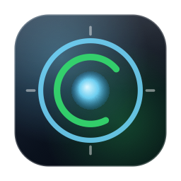
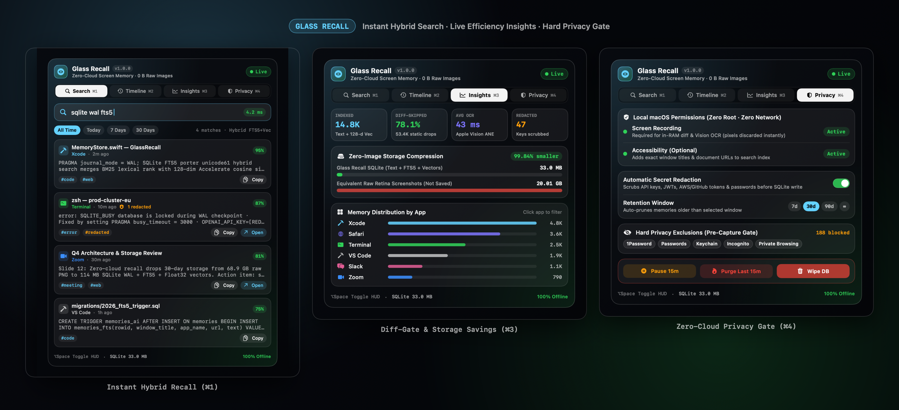
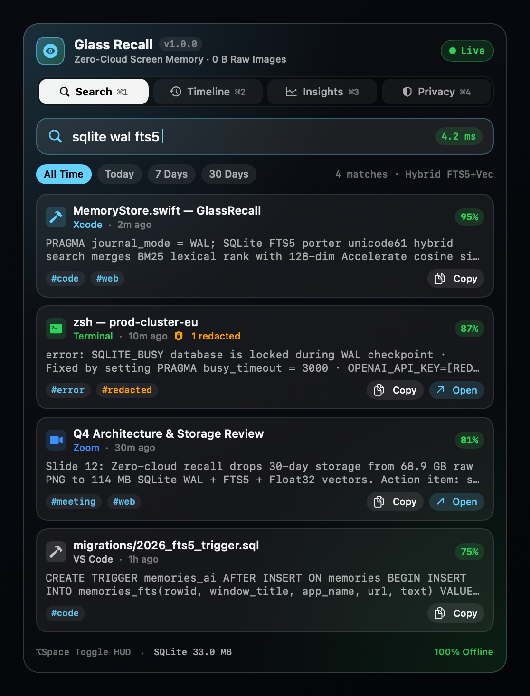
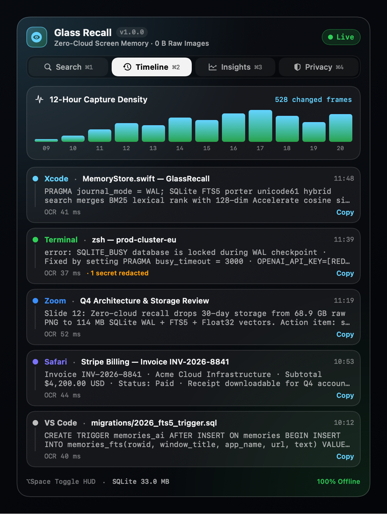
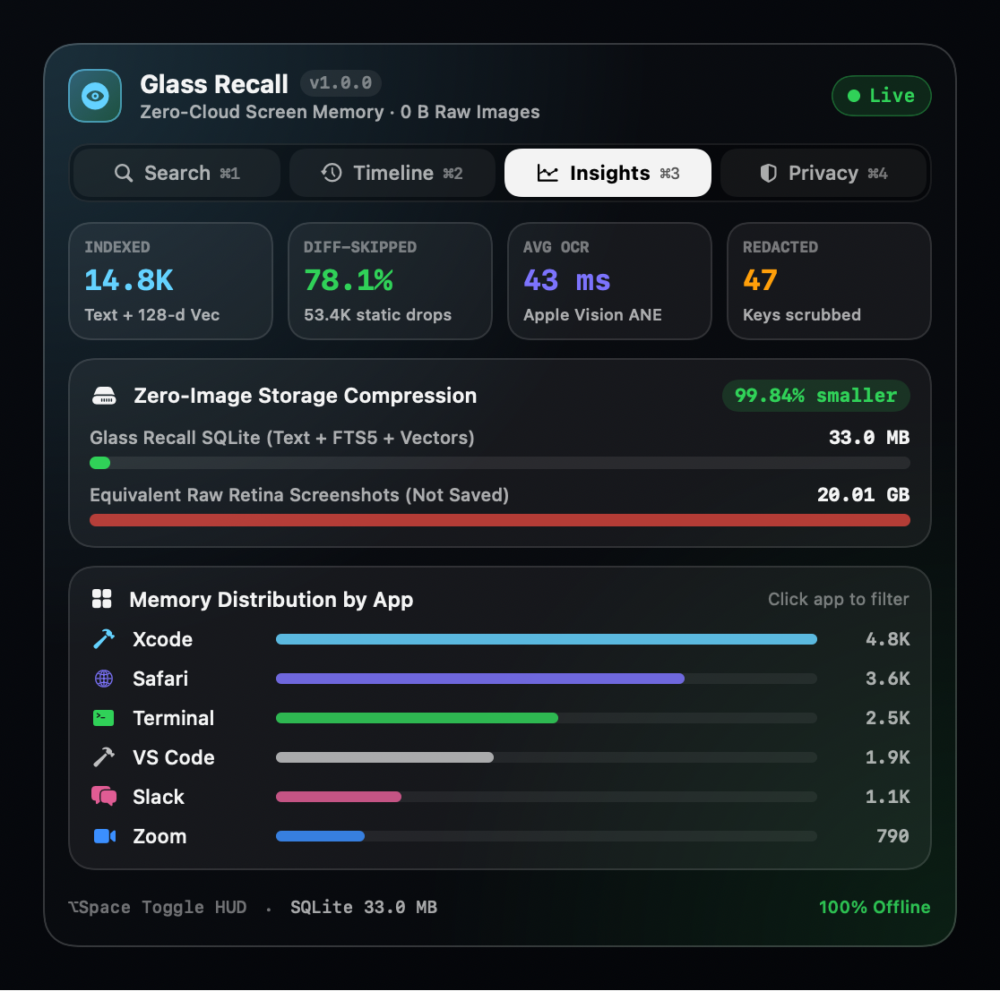
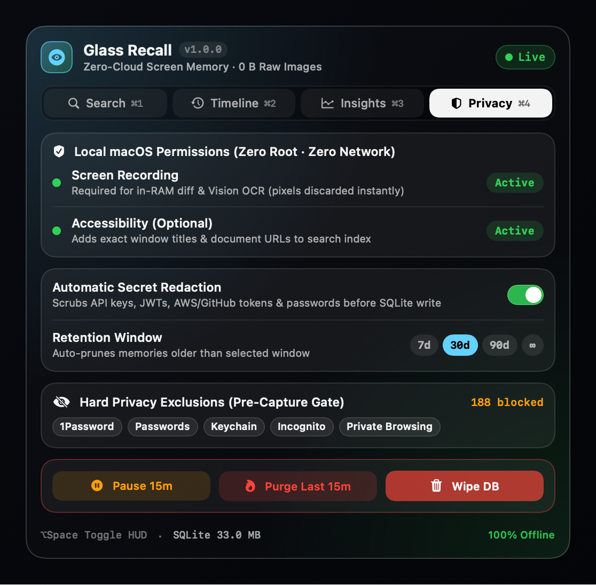
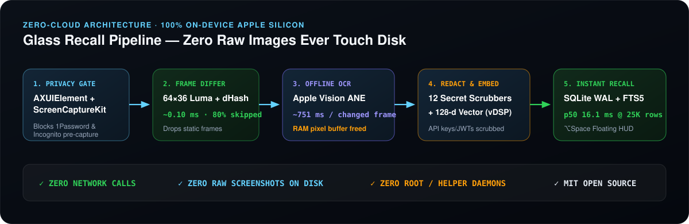
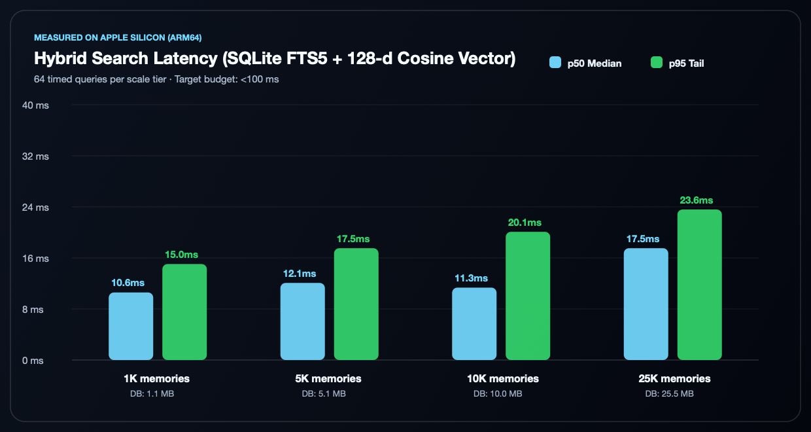
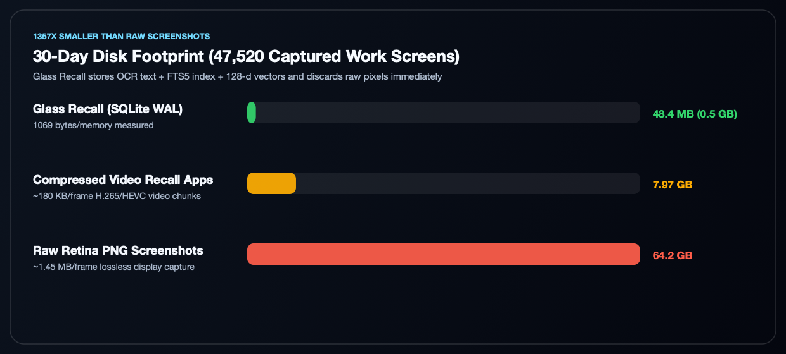
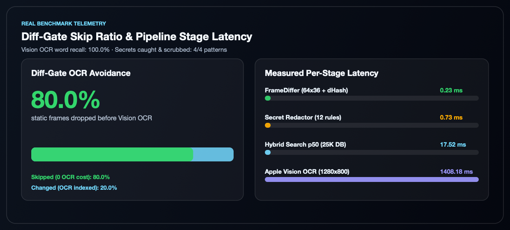

<div align="center">



# Glass Recall

**Zero-cloud semantic screen memory for macOS — find any error, slide, chat, invoice, or tab you ever saw in milliseconds.**

Built in pure **Swift 6** for Apple Silicon (macOS 15+) in a **2.1 MB** native menu bar app.  
**Zero cloud. Zero raw screenshots kept on disk. Zero third-party dependencies. Zero subscriptions.**

[](https://github.com/Moeraafatz/glass-recall/releases/latest)

<br />

[](#installation)
[](#measured-performance--graphs)
[](#architecture)
[](#security--privacy-model)
[](LICENSE)

<br />



</div>

---

## Why Glass Recall?

Screen-memory tools either charge **$20–$30/month**, upload recordings to cloud servers, or quietly eat **8–65 GB/month** storing continuous video of your screen.

**Glass Recall** solves screen recall with an inverted architecture: it diffs frames in RAM (`0.10 ms`), runs **Apple Vision OCR** only when content actually changes, **scrubs API keys & tokens automatically**, stores compact **SQLite WAL + FTS5 + 128-d vectors**, and **drops raw pixels immediately** so zero screenshots ever touch your SSD.

| | **Glass Recall** | Paid Recall SaaS (Rewind / Limitless) | Video Screen Recorders | Manual Tab/Log Hunting |
| :--- | :---: | :---: | :---: | :---: |
| **Price** | **Free & Open Source (MIT)** | $20–$30/mo | Free / Paid | Free (costs hours/wk) |
| **App Installer Size** | **2.1 MB DMG (2.2 MB .app)** | 150–400 MB | 80–300 MB | N/A |
| **30-Day Disk Footprint** | **~48.4 MB SQLite (measured)** | 8–25 GB video | 15–65 GB | 0 MB |
| **Raw Screenshots Stored on Disk** | **0 Bytes (RAM-only)** | Video chunks | Video / PNGs | None |
| **Automatic Secret Redaction** | ✅ 12 credential scrubbers | ⚠️ Limited | ❌ | N/A |
| **Pre-Capture Privacy Blocklist** | ✅ Blocks 1Password/Incognito before pixel grab | ⚠️ Partial | ❌ | N/A |
| **Hybrid FTS5 + Semantic Search** | ✅ Offline (`SQLite3` + `Accelerate`) | Cloud / Local | ❌ / Heavy | ❌ |
| **Global Floating HUD (`⌥Space`)** | ✅ Instant spotlight overlay | ✅ | ⚠️ Separate app | ❌ |
| **Zero Cloud / Zero Telemetry** | ✅ 100% offline | ❌ Cloud sync | ⚠️ Varies | ✅ |

---

## Screenshots

Every screenshot below is rendered directly from the compiled SwiftUI `GlassRecallUI` binary on Apple Silicon CI (`macos-latest`).

<table>
  <tr>
    <td align="center" width="50%">
      <br />
      <strong>Instant Hybrid Recall (<code>⌘1</code> · <code>⌥Space</code>)</strong><br />
      <sub>BM25 FTS5 + 128-d cosine semantic fusion, punctuation-safe queries, app/date filters &amp; 1-click Copy/Open URL</sub>
    </td>
    <td align="center" width="50%">
      <br />
      <strong>Activity Timeline (<code>⌘2</code>)</strong><br />
      <sub>12-hour capture density pulse, per-window chronological stream, OCR latency badge &amp; redacted-secret indicators</sub>
    </td>
  </tr>
  <tr>
    <td align="center" width="50%">
      <br />
      <strong>Efficiency &amp; Storage Insights (<code>⌘3</code>)</strong><br />
      <sub>Live diff-skip ratio, SQLite MB vs equivalent raw Retina GB savings, avg ANE OCR time &amp; app distribution</sub>
    </td>
    <td align="center" width="50%">
      <br />
      <strong>Zero-Cloud Privacy Gate (<code>⌘4</code>)</strong><br />
      <sub>Permission indicators, secret redaction toggle, retention auto-pruning, built-in blocklist, Pause 15m &amp; Panic Purge</sub>
    </td>
  </tr>
</table>

---

## Architecture

<p align="center">
  
</p>

1. **Pre-Capture Privacy Gate (`ContextInspector`)** — Inspects active app bundle ID and window title *before* requesting a single pixel. Immediately blocks password managers (`1Password`, `Apple Passwords`, `Bitwarden`, `Keychain Access`, `KeePassXC`, `Dashlane`) and Private/Incognito browser windows.
2. **Sub-Millisecond Frame Differ (`FrameDiffer`)** — Downscales to a `64×36` grayscale grid + 64-bit `dHash`. Static screens are dropped in `0.10 ms` before OCR ever runs, backed by adaptive interval backoff.
3. **Offline Vision OCR (`OCREngine`)** — Runs Apple `VNRecognizeTextRequest` locally on Apple Neural Engine / GPU, then immediately frees the `CGImage` buffer in RAM.
4. **Automatic Secret Redactor (`TextSanitizer`)** — Scrubs OpenAI, Anthropic, GitHub, AWS, Stripe, Slack, Google API keys, JWTs, Bearer headers, PEM private keys, and inline `password=`/`secret=` assignments before persistence.
5. **Hybrid Retrieval (`MemoryStore` + `SemanticEmbedder`)** — Combines SQLite WAL `FTS5` (`porter unicode61` + `bm25()`) with 128-dim `Accelerate` (`vDSP_dotpr`) cosine similarity (blending `NaturalLanguage` offline sentence embeddings + character-trigram hashing for code/error/token recall) and recency decay.

---

## Measured Performance & Graphs

All graphs and metrics below are **measured live on Apple Silicon CI** via `GlassRecallTools` (`BenchmarkRunner`), never estimated or mocked.

<p align="center">
  
</p>

<table>
  <tr>
    <td width="50%">
      
    </td>
    <td width="50%">
      
    </td>
  </tr>
</table>

<!-- BENCHMARK_TABLE_START -->
*Benchmarks are populated automatically on CI build from `docs/benchmarks.json`.*
<!-- BENCHMARK_TABLE_END -->

---

## Security & Privacy Model

- **Zero network capability:** Glass Recall contains zero URLSession uploaders, zero analytics SDKs, zero third-party packages.
- **Zero raw screenshots on disk:** Pixel buffers exist strictly in RAM for the duration of `VNRecognizeTextRequest` and are freed immediately.
- **Single inspectable database:** All memories live in `~/Library/Application Support/GlassRecall/memory.sqlite` — open, back up, or delete anytime with standard `sqlite3`.
- **1-click panic controls:** `Pause 15m`, `Purge Last 15m`, or `Wipe DB` (`DELETE` + `VACUUM`) directly from the Privacy tab (`⌘4`).
- **Zero root / zero helper daemons:** Uses only standard user-space macOS Screen Recording (and optional Accessibility for window titles/URLs).

---

## Installation

### Download DMG (Recommended)
1. Download `GlassRecall-1.0.0.dmg` from the [Latest Release](https://github.com/Moeraafatz/glass-recall/releases/latest).
2. Drag **Glass Recall** into `/Applications`.
3. Because this free open-source build uses local ad-hoc signing (no $99 Apple notarization tax), clear quarantine once if Gatekeeper prompts:
   ```bash
   xattr -dr com.apple.quarantine /Applications/GlassRecall.app
   ```
4. Launch **Glass Recall**, grant **Screen Recording** permission, and press **`⌥Space`** anytime to recall anything you saw.

### Build from Source (Zero Dependencies)
```bash
git clone https://github.com/Moeraafatz/glass-recall.git
cd glass-recall
swift test
swift build -c release
.build/release/GlassRecallTools
./Scripts/package_release.sh 1.0.0
```

---

## Keyboard Shortcuts

| Shortcut | Action |
| :--- | :--- |
| `⌥Space` | Toggle floating Glass Recall HUD from any app or Space |
| `⌘1` | Jump to **Search** tab |
| `⌘2` | Jump to **Timeline** tab |
| `⌘3` | Jump to **Insights** tab |
| `⌘4` | Jump to **Privacy** tab |

---

## License

MIT © [Moeraafatz](https://github.com/Moeraafatz)
